# 🎵 SONGCODE by JMSCNC

### Guitar Pro tabs and MIDI files in. G-code out. Your CNC's stepper motors play the song.

**▶ [Open SONGCODE in your browser](https://revjmoney.github.io/songcode/)** · nothing to install, your files never leave your computer

[jmscnc.com](https://jmscnc.com) · [RotatoCAM](https://rotatocam.com) · [REVTURN lathe](https://revjmoney.github.io/revturn-lathe-firmware/) · [YouTube](https://www.youtube.com/@REVJMONEY) · [X @StunGod](https://x.com/StunGod) · [Instagram](https://www.instagram.com/revjmoney) · [Twitch](https://www.twitch.tv/revjmoney) · [SoundCloud](https://soundcloud.com/revjmoney) · [GitHub](https://github.com/revjmoney) · [☕ Buy me a coffee](https://buymeacoffee.com/revjmoney)

[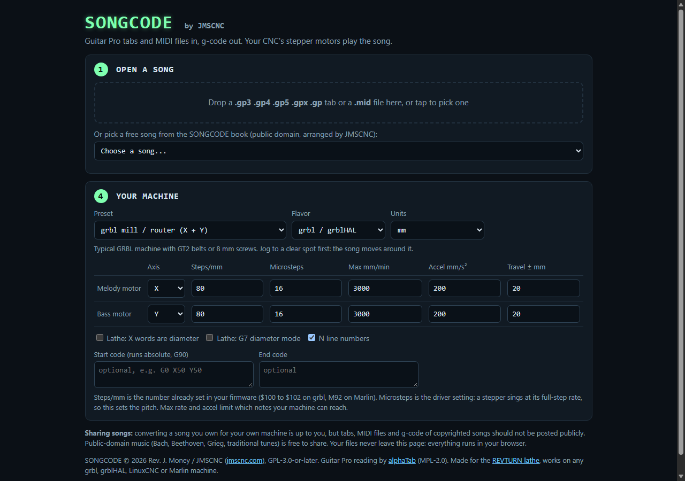](https://revjmoney.github.io/songcode/)

A stepper motor hums at a pitch set by how fast it steps. SONGCODE turns every note of a song into a move at
exactly the feed rate that makes your motor sing that note: the melody on one axis, the bass on another, both at
once. Drop in a Guitar Pro tab or a MIDI file, pick the parts, tell it about your machine, and download a `.nc`
file for grbl, grblHAL, LinuxCNC or Marlin.

Made by **Rev. J. Money / [JMSCNC](https://jmscnc.com)** for the **[REVTURN](https://revjmoney.github.io/revturn-lathe-firmware/)**
junk-bin CNC lathe, and it works on mills, routers, laser gantries and 3D printers too.
From the maker of **[RotatoCAM](https://rotatocam.com)**: 4- and 3-axis CAM for DIY CNC.

## 🎬 Hear it

| Für Elise, made with SONGCODE, played by the REVTURN lathe | In the Hall of the Mountain King on the REVTURN lathe |
|---|---|
| [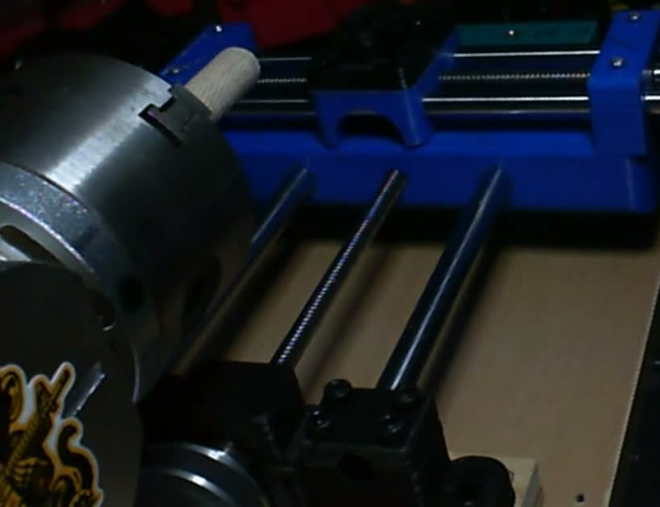](docs/media/fur-elise-on-revturn.mp4) | [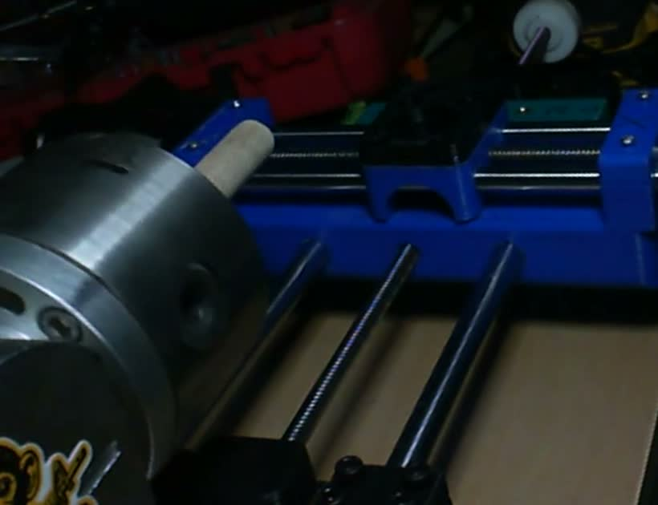](docs/media/mountain-king-on-revturn.mp4) |
| [▶ Watch with sound (2.4 MB)](docs/media/fur-elise-on-revturn.mp4) | [▶ Watch with sound (3.9 MB)](docs/media/mountain-king-on-revturn.mp4) |

The lathe's X axis plays the melody and Z plays the bass. Both songs are public domain.

---

## ⚠️ SAFETY FIRST!!

**SONGCODE g-code MOVES YOUR MACHINE.** Every note is a real move, hundreds of them, back and forth, at real feed
rates. Treat a song like any other program you have never run before.

**Before you press start:**

- 🛑 **Know where your feed hold and E-stop are, and keep a hand near them** for the whole song.
- 🔧 **No cutting.** Spindle **off**, laser **off**, hot end **cold**. SONGCODE never turns them on, so if your start
  code or your machine does, stop.
- 🧹 **Clear the work area.** Take the part and the stock out. Remove clamps, vises, probes, cables and anything
  that sits in the travel.
- 🪚 **Lathe:** the **chuck must be clear**: no stock in the jaws, jaws closed down, **chuck key out**, nothing on the
  cross slide that can reach the chuck or the tailstock. Keep the spindle off for the whole song.
- 🪵 **Mill / router:** **no bit in the collet**, or raise Z well clear of everything. SONGCODE only moves the two
  axes you choose, so Z stays wherever you leave it.
- 🖨️ **3D printer:** home it, **lift Z** a few centimetres, bed clear, nozzle cold.
- 📏 **Check the room:** the song moves up to **± the travel box** you set (shown as **X travel / Y travel** on the result) around
  the start point. Make sure that box fits inside your machine's travel **with margin** on every side.
- 👂 **Start small:** convert a 10 to 15 second section first and watch it. Stepper music can be loud: protect
  your ears and your neighbours.
- 👀 **Never leave it running alone.** Kids, pets and hands stay out of the machine.

If a note is out of reach (too fast for your max rate) SONGCODE moves it by an octave and tells you. If your
machine stalls, skips or rattles hard, stop, then lower the speed % or pick a shorter, simpler section.

## 🎯 Where to put zero (the start point)

Every SONGCODE program is **relative** (`G91`): it starts **wherever the tool is**, wanders around that spot
inside the travel box, and **ends back exactly where it started**. So the start point is everything.

**Any machine (mill, router, printer, LinuxCNC, plain grbl):**

1. Home the machine (or jog it) so the axes are free to move.
2. **Jog to the middle of a clear area**, at least the travel box away from every limit, clamp and wall. Example:
   with a ±20 mm box, leave at least 25 mm free on every side of the tool, on both song axes.
3. On a router or mill, raise Z so the tool cannot touch anything. On a printer, lift Z.
4. Leave **Start code** empty (or put your own safe moves there: they run in absolute `G90`).
5. Load the `.nc` file and run it. When it ends, the tool is back where you started.

**REVTURN lathe preset:** this preset has start code that first moves to **`Z-1.375 X0`** in work coordinates,
and end code that parks at **`Z-0.25 X0`**. That is the REVTURN "test room": **X0 = the middle of X travel,
Z0 = near the tailstock end of Z travel**, with about 3 in of clear Z toward the chuck. The song then moves
**X ± 0.65 in (diameter words, so ± 1.3 in on the DRO) and Z ± 0.4 in** around that spot.

1. Take the stock out of the chuck, close the jaws down, pull the chuck key, spindle off.
2. Jog X to the **middle of its travel** and set **X0** there. (This is not the spindle centre line. The song
   needs room on both sides.)
3. Jog Z to about **3 in out from the chuck jaws**, toward the tailstock, and set **Z0** there.
4. Jog to **Z-1.375 X0** by hand and look: the tool and tool post must clear the chuck, the jaws and the
   tailstock by at least **0.5 in** with **Z ± 0.4** and **X ± 0.65** on top. If not, move your zero or clear the
   start code and jog to a safe spot yourself (then the song plays around wherever you are).

If your lathe is not a REVTURN, use the plain grbl preset with your own axis letters and numbers, untick the
lathe boxes if you do not use diameter mode, and leave the start code empty.

## 🧰 How to use it

### 1. Open a song

[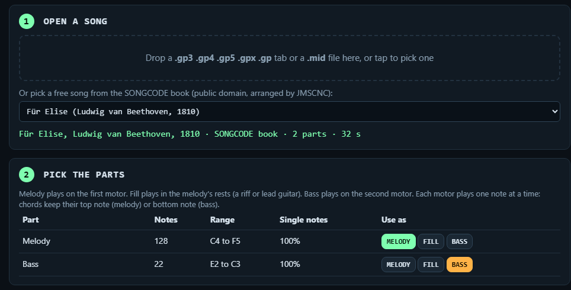](docs/screenshots/02-song-book.png)

Drop in a **Guitar Pro** tab (`.gp3 .gp4 .gp5 .gpx .gp`) or a **MIDI** file (`.mid`), or pick one of the **free
songs in the SONGCODE book**. Repeats are played out and tempo changes are kept. Drum tracks are left out (a
machine cannot hit a drum in the middle of a melody move).

### 2. Pick the parts

[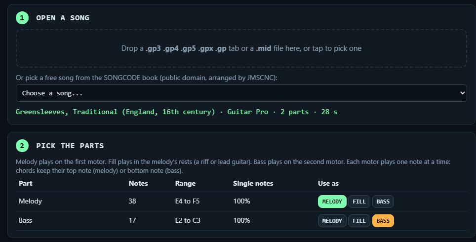](docs/screenshots/05-guitar-pro-tab.png)

- **MELODY** plays on the first motor: usually the vocal line or the lead.
- **FILL** plays only while the melody rests (a riff or lead guitar fills the gaps between vocal lines).
- **BASS** plays on the second motor.

SONGCODE guesses all three (vocal or lead names first, the most single-note parts, the lowest part for bass).
Each motor plays one note at a time: chords keep their top note (melody) or bottom note (bass).

### 3. Section, sound and your machine

[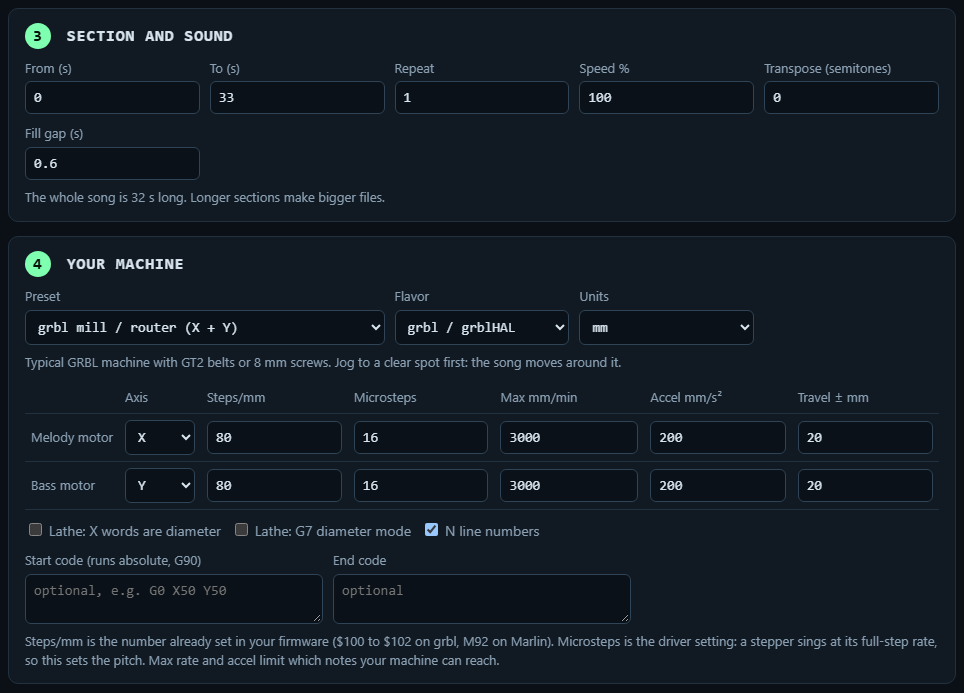](docs/screenshots/03-section-and-machine.png)

- **From / To:** the part of the song to play (it starts 8 s before the melody by default). **Repeat** loops it.
- **Speed %** and **Transpose** change tempo and key. **Fill gap** sets how long a melody rest must be before the fill plays.
- **Machine:** pick a preset (REVTURN lathe, grbl mill / router, Marlin 3D printer, LinuxCNC) and edit it:
  - **Axis**: which two axes sing (X, Y, Z, A, B or C).
  - **Steps/mm**: what your firmware already uses (`$100`-`$102` on grbl, `M92` on Marlin).
  - **Microsteps**: your driver setting. A stepper sings at its full-step rate, so this sets the pitch.
  - **Max mm/min** and **Accel**: your machine's limits. Notes faster than the max get moved down an octave.
  - **Travel ±**: how far each axis may wander from the start point.
- **Flavor** sets the dialect: grbl/grblHAL and LinuxCNC dwell in seconds, Marlin dwells in milliseconds, uses no
  line numbers and no `M30`. Your settings are remembered in your browser.

### 4. Listen, check, download

[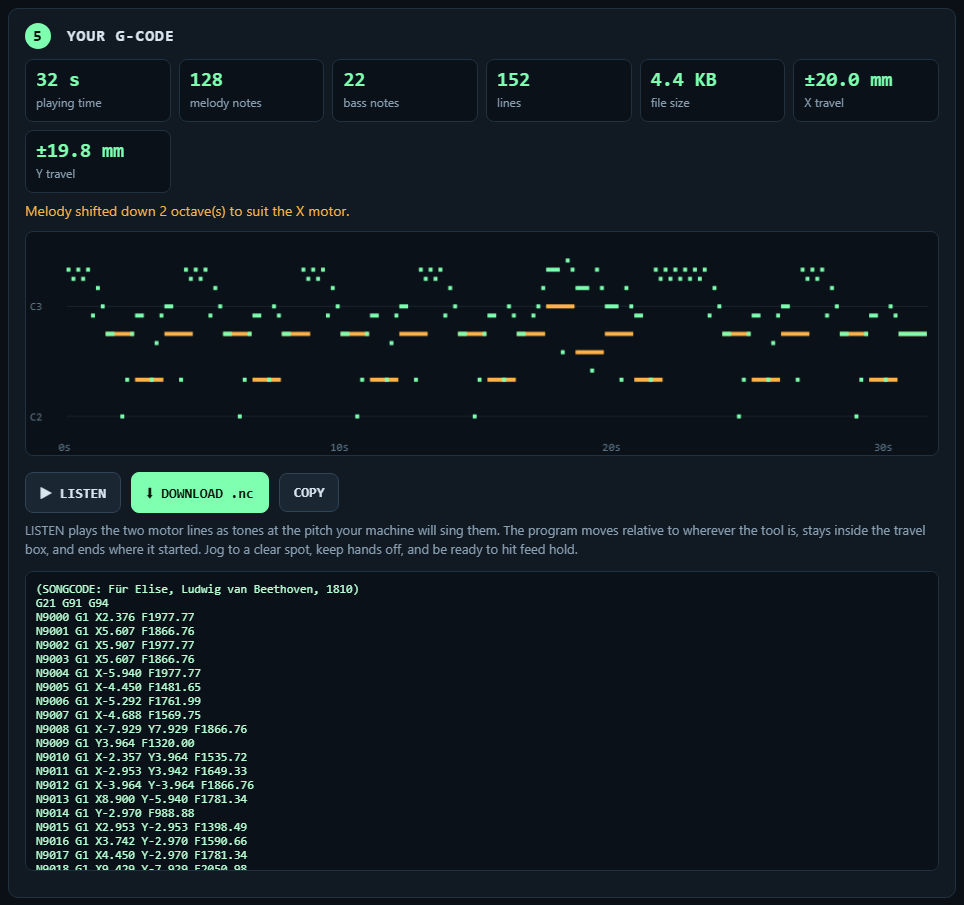](docs/screenshots/04-result-grbl.png)

**▶ LISTEN** plays both motor lines as tones at the pitch your machine will sing them. The plot shows every note
(green = melody, orange = bass). Check the **travel** numbers against your machine, then **⬇ DOWNLOAD .nc** and run
it from your sender (gSender, UGS, CNCjs, the REVTURN screen, OctoPrint, LinuxCNC...).

| REVTURN lathe preset | Marlin 3D printer preset |
|---|---|
| [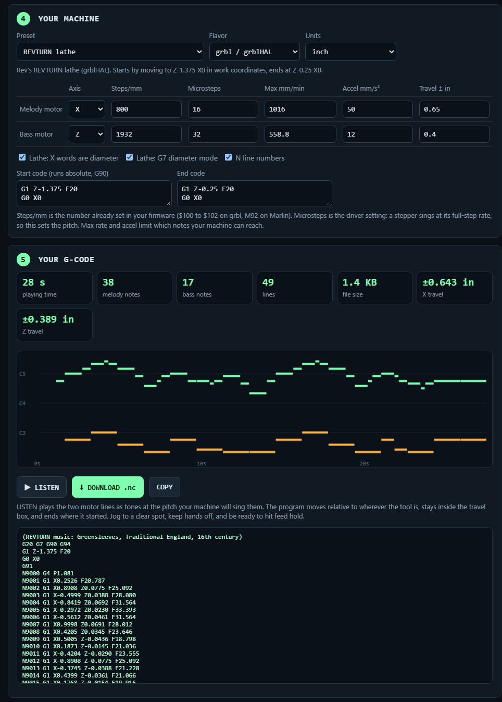](docs/screenshots/06-revturn-lathe.png) | [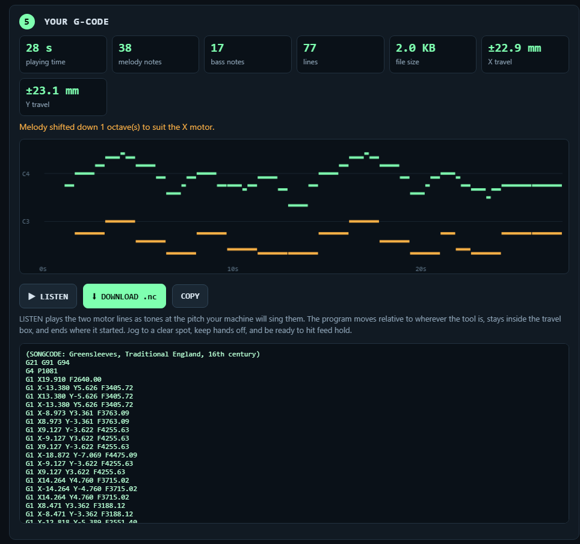](docs/screenshots/07-marlin.png) |

| Notes plot (Mountain King on a grbl router) | On a phone |
|---|---|
| [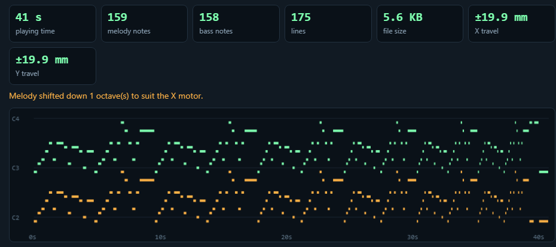](docs/screenshots/08-mountain-king-plot.png) | [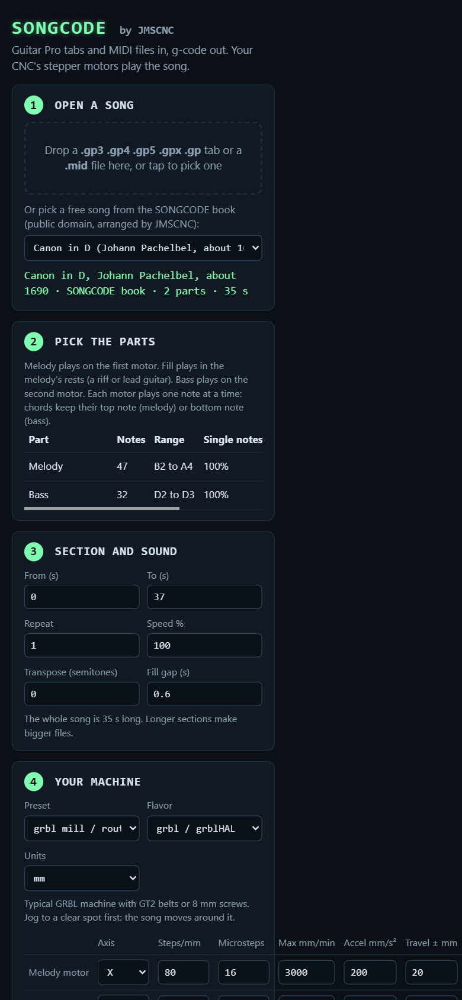](docs/screenshots/09-phone.png) |

## 🎼 Free songs included

All of these are **public-domain melodies, arranged for two stepper motors by JMSCNC**, written out from the old
tunes (not copied from anyone else's file). Each comes as a MIDI file, a Guitar Pro tab, and ready-to-run g-code
for the REVTURN lathe and for a typical grbl X+Y machine (80 steps/mm at 16x, ±20 mm).

| Song | Composer | Length | MIDI | Tab | G-code |
|---|---|---|---|---|---|
| Gymnopédie No. 1 | Erik Satie, 1888 | 76 s | [mid](songs/midi/gymnopedie.mid) | [gp](songs/tabs/gymnopedie.gp) | [lathe](songs/gcode/gymnopedie-revturn.nc) · [grbl X+Y](songs/gcode/gymnopedie-grbl-xy.nc) |
| Für Elise | Ludwig van Beethoven, 1810 | 32 s | [mid](songs/midi/fur-elise.mid) | [gp](songs/tabs/fur-elise.gp) | [lathe](songs/gcode/fur-elise-revturn.nc) · [grbl X+Y](songs/gcode/fur-elise-grbl-xy.nc) |
| In the Hall of the Mountain King | Edvard Grieg, 1875 | 41 s | [mid](songs/midi/mountain-king.mid) | [gp](songs/tabs/mountain-king.gp) | [lathe](songs/gcode/mountain-king-revturn.nc) · [grbl X+Y](songs/gcode/mountain-king-grbl-xy.nc) |
| Moonlight Sonata (1st movement) | Ludwig van Beethoven, 1801 | 48 s | [mid](songs/midi/moonlight.mid) | [gp](songs/tabs/moonlight.gp) | [lathe](songs/gcode/moonlight-revturn.nc) · [grbl X+Y](songs/gcode/moonlight-grbl-xy.nc) |
| Ode to Joy | Ludwig van Beethoven, 1824 | 32 s | [mid](songs/midi/ode-to-joy.mid) | [gp](songs/tabs/ode-to-joy.gp) | [lathe](songs/gcode/ode-to-joy-revturn.nc) · [grbl X+Y](songs/gcode/ode-to-joy-grbl-xy.nc) |
| Twinkle, Twinkle, Little Star | Traditional, 1761 | 20 s | [mid](songs/midi/twinkle.mid) | [gp](songs/tabs/twinkle.gp) | [lathe](songs/gcode/twinkle-revturn.nc) · [grbl X+Y](songs/gcode/twinkle-grbl-xy.nc) |
| Amazing Grace | Traditional ("New Britain", 1829) | 28 s | [mid](songs/midi/amazing-grace.mid) | [gp](songs/tabs/amazing-grace.gp) | [lathe](songs/gcode/amazing-grace-revturn.nc) · [grbl X+Y](songs/gcode/amazing-grace-grbl-xy.nc) |
| Greensleeves | Traditional, 16th century | 26 s | [mid](songs/midi/greensleeves.mid) | [gp](songs/tabs/greensleeves.gp) | [lathe](songs/gcode/greensleeves-revturn.nc) · [grbl X+Y](songs/gcode/greensleeves-grbl-xy.nc) |
| When the Saints Go Marching In | Traditional | 28 s | [mid](songs/midi/saints.mid) | [gp](songs/tabs/saints.gp) | [lathe](songs/gcode/saints-revturn.nc) · [grbl X+Y](songs/gcode/saints-grbl-xy.nc) |
| Scarborough Fair | Traditional | 26 s | [mid](songs/midi/scarborough-fair.mid) | [gp](songs/tabs/scarborough-fair.gp) | [lathe](songs/gcode/scarborough-fair-revturn.nc) · [grbl X+Y](songs/gcode/scarborough-fair-grbl-xy.nc) |
| Canon in D | Johann Pachelbel, about 1690 | 35 s | [mid](songs/midi/canon-in-d.mid) | [gp](songs/tabs/canon-in-d.gp) | [lathe](songs/gcode/canon-in-d-revturn.nc) · [grbl X+Y](songs/gcode/canon-in-d-grbl-xy.nc) |

⚠️ The ready-made g-code assumes those exact machine numbers. For your machine, open the song in SONGCODE and
enter your own. Read **SAFETY FIRST!!** and **Where to put zero** before running any of them.

## ⚖️ Your songs and copyright

Converting a song you own to play on your own machine is up to you. But **tabs, MIDI files, g-code and recordings
of copyrighted songs belong to their rights holders, so don't post them publicly.** Public-domain music
(Bach, Beethoven, Grieg, Satie, traditional tunes) is free to share. Everything runs in your browser and nothing
is uploaded anywhere.

## 🛠️ Build it yourself

```bash
npm install
```

```bash
npm test
```

```bash
npm run build
```

`dist/index.html` is the whole app in one file: open it straight from disk, or host it anywhere. GitHub Pages
builds and publishes it on every push to `main` (`.github/workflows/pages.yml`).

| Path | What it is |
|---|---|
| `src/app/` | the page (HTML, CSS, JS) |
| `src/music/load.js` | opens Guitar Pro (through alphaTab) and MIDI files |
| `src/music/arrange.js` | picks the parts, melody + fill + bass, machine presets, start / end code |
| `src/music/build.js` | the note-to-move engine: feed = pitch, legato moves, travel box, g-code words per flavor |
| `songs/book.js` | the free song book (JMSCNC arrangements of public-domain tunes) |
| `tools/make-songs.mjs` | writes `songs/midi`, `songs/tabs` and `songs/gcode`, and checks every tab against the book |
| `tools/shots.mjs` | takes the README screenshots |

**How the pitch works:** a stepper sings at its full-step rate. Full steps per mm = steps/mm ÷ microsteps, so a note
of *f* Hz needs a feed of *f* ÷ (full steps per mm) × 60 mm/min. Two notes at once means one combined move whose X
and Y (or X and Z) speeds are each one note. Each note keeps rolling the same way and only reverses at the edge of
the travel box, so it sounds smooth instead of plucked.

## 📜 License

**SONGCODE by JMSCNC, Copyright (C) 2026 Rev. J. Money / JMSCNC (jmscnc.com).** Free software under the
**GNU GPL v3 or later** with an attribution term (GPLv3 section 7(b)): keep "SONGCODE by JMSCNC, Copyright (C) 2026
Rev. J. Money / JMSCNC (jmscnc.com)" in every copy and changed version. See [`LICENSE`](LICENSE) and
[`NOTICE.md`](NOTICE.md). Guitar Pro reading by [alphaTab](https://www.alphatab.net) (MPL-2.0).

---

**Like it?** ☕ **[Buy me a coffee](https://buymeacoffee.com/revjmoney)**, check out **[RotatoCAM](https://rotatocam.com)**
(rotary and 3-axis CAM for DIY CNC), build a **[REVTURN lathe](https://revjmoney.github.io/revturn-lathe-firmware/)**,
or shop at **[jmscnc.com](https://jmscnc.com)**. Follow along on [YouTube](https://www.youtube.com/@REVJMONEY),
[X @StunGod](https://x.com/StunGod), [Instagram](https://www.instagram.com/revjmoney) and [Twitch](https://www.twitch.tv/revjmoney).
